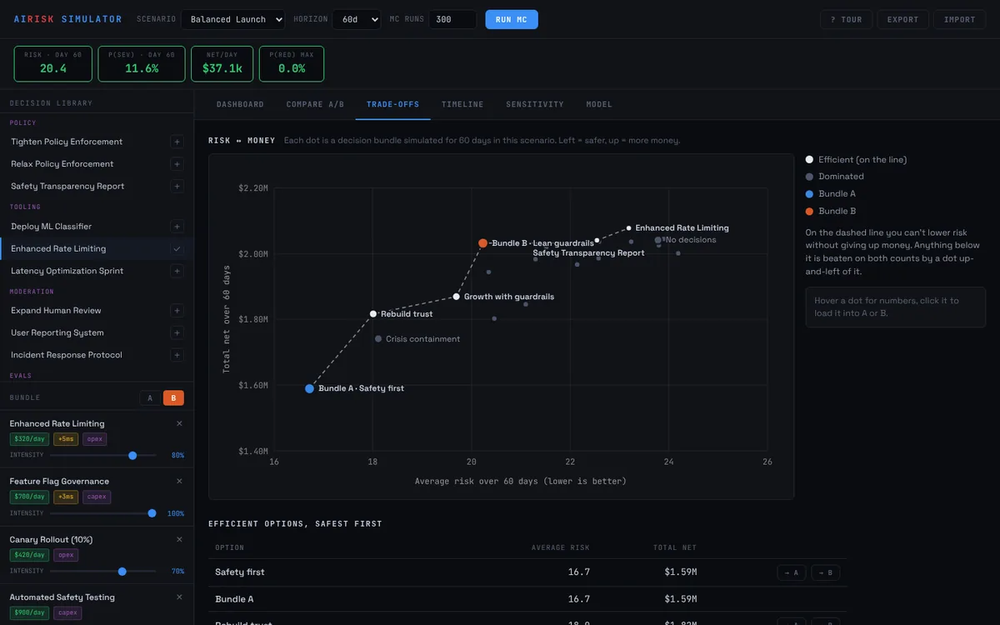
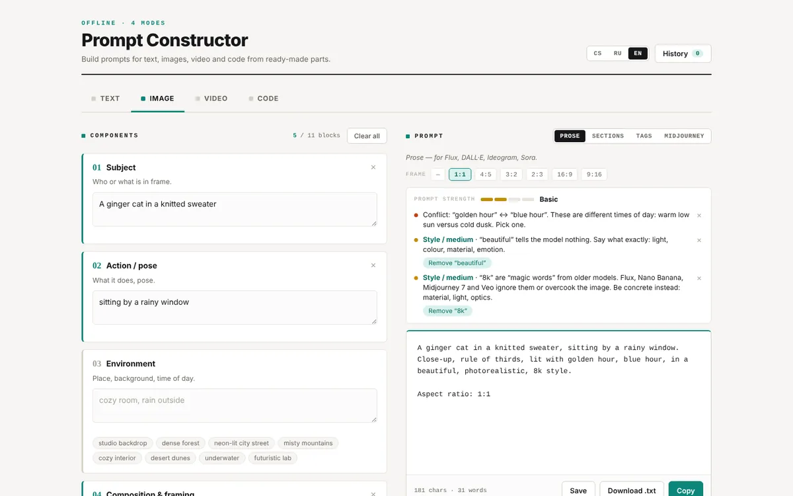
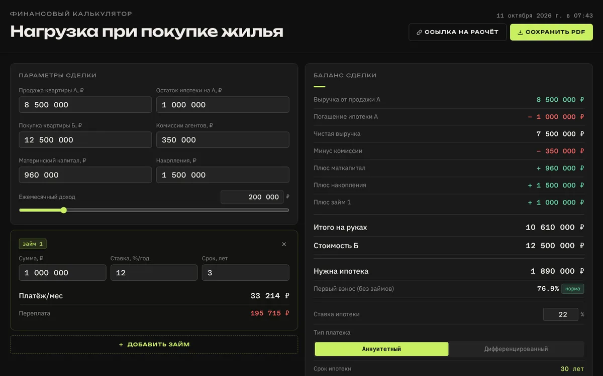
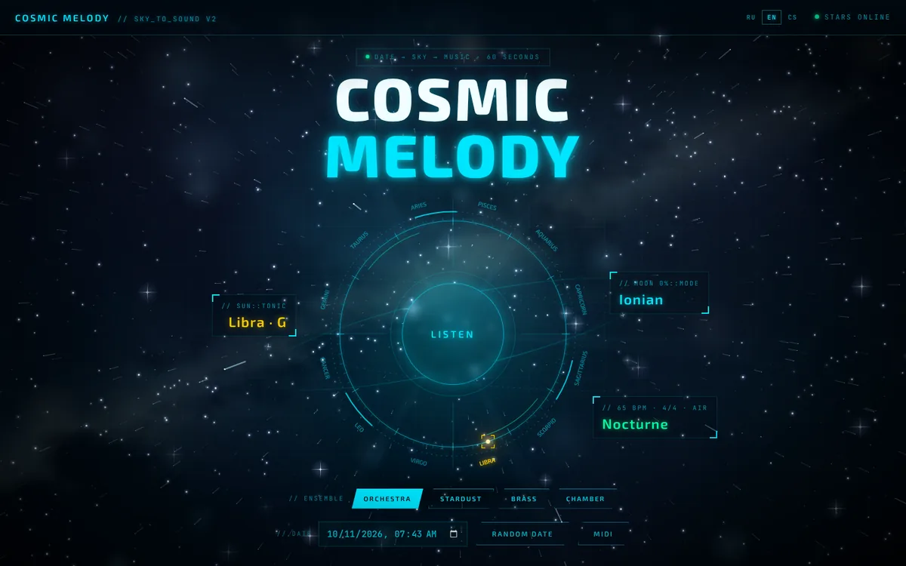

### OZ — визуальный и продуктовый дизайнер

Одиннадцать лет делал графический дизайн в международных агентствах, теперь ухожу в продуктовый. Здесь — вещи, которые я спроектировал и собрал сам. Все работают прямо в браузере.

**Все проекты на одной странице: [oz-the-magician.github.io](https://oz-the-magician.github.io/)**

<table>
  <tr>
    <td width="50%" valign="top">
      
       <b><a href="https://oz-the-magician.github.io/AI-Product-Risk-Simulator-Decision-Support-System-v3/">AI Risk Simulator</a></b> 
      Симулятор решений по безопасности AI-продукта: два набора мер, риск против денег, вклад каждого решения.
       <a href="https://github.com/oz-the-magician/AI-Product-Risk-Simulator-Decision-Support-System-v3">код</a>
    </td>
    <td width="50%" valign="top">
      
       <b><a href="https://oz-the-magician.github.io/prompt-constructor/">Prompt Constructor</a></b> 
      Конструктор промптов для текста, изображений, видео и кода — с подсказками, что ослабляет промпт.
       <a href="https://github.com/oz-the-magician/prompt-constructor">код</a>
    </td>
  </tr>
  <tr>
    <td width="50%" valign="top">
      
       <b><a href="https://oz-the-magician.github.io/mortgage_calculator/">Калькулятор ипотеки</a></b> 
      Продаёте одну квартиру, покупаете другую: сколько ипотеки нужно и какая доля дохода уйдёт на платёж.
       <a href="https://github.com/oz-the-magician/mortgage_calculator">код</a>
    </td>
    <td width="50%" valign="top">
      
       <b><a href="https://oz-the-magician.github.io/blaster-arena/">Blaster Arena</a></b> 
      Браузерный 3D-шутер на арене: волны ботов, гигант-босс, 18 видов оружия, разрушаемые стены.
       <a href="https://github.com/oz-the-magician/blaster-arena">код</a>
    </td>
  </tr>
  <tr>
    <td width="50%" valign="top">
      
       <b><a href="https://oz-the-magician.github.io/cosmic-melody/">Cosmic Melody</a></b> 
      Превращает дату в минуту музыки по положению Солнца и фазе Луны.
       <a href="https://github.com/oz-the-magician/cosmic-melody">код</a>
    </td>
    <td width="50%" valign="top"></td>
  </tr>
</table>

Visual and product designer. Eleven years of graphic design at international agencies, now moving into product design. Everything above runs in the browser — the full list is at <a href="https://oz-the-magician.github.io/">oz-the-magician.github.io</a>.
